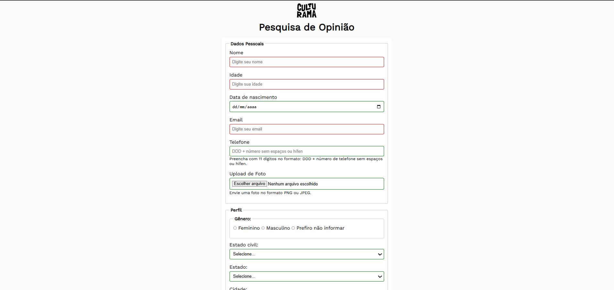

# Pesquisa Culturama

Formulário de pesquisa desenvolvido com HTML5 e CSS3, com foco em responsividade, acessibilidade e construção de interfaces web.

## Preview do projeto

<!-- Insira a captura de tela do projeto abaixo -->

## Sobre o projeto

O Pesquisa Culturama é um projeto prático de desenvolvimento Front-end que consiste na criação de um formulário de pesquisa. O projeto explora a estruturação semântica de páginas web, a estilização de interfaces e a aplicação de práticas de acessibilidade e design responsivo.

## Tecnologias e ferramentas

- **HTML5** — estruturação semântica do conteúdo e dos campos do formulário.
- **CSS3** — estilização, layout e adaptação da interface a diferentes tamanhos de tela.
- **Figma** — apoio ao processo de design da interface.
- **Git** — controle de versão.
- **GitHub** — hospedagem do código-fonte e publicação do projeto.

## Funcionalidades

- Formulário para preenchimento de respostas de pesquisa.
- Interface responsiva para diferentes tamanhos de tela.
- Indicação visual de erros de validação.

## Responsividade

A interface foi desenvolvida para se adaptar a diferentes tamanhos de tela, buscando preservar a organização do conteúdo, a legibilidade e a usabilidade em dispositivos móveis e desktops.

## Acessibilidade

O projeto incorpora práticas de acessibilidade na construção do formulário, com o objetivo de facilitar a compreensão dos campos e a interação dos usuários.

- **Identificação dos campos:** associação entre elementos `<label>` e seus respectivos campos.
- **HTML semântico:** uso de `<fieldset>` e `<legend>` para agrupar campos relacionados.
- **Contraste de cores:** escolha de combinações que favorecem a legibilidade.
- **Validação do formulário:** mensagens ou estilos visuais para indicar erros de preenchimento.
- **Atributos ARIA:** utilização quando necessários para complementar a semântica e apoiar tecnologias assistivas.

## Publicação

O projeto está disponível no GitHub Pages:

[Visualizar Pesquisa Culturama](https://kaleo-a-m.github.io/pesquisa-culturama/)

## Autor

**Kaléo Maciel**

Desenvolvedor Front-end em formação, com foco na criação de interfaces web utilizando HTML e CSS, priorizando responsividade, acessibilidade e qualidade de implementação.

**GitHub:** [Kaleo-A-M](https://github.com/Kaleo-A-M)
